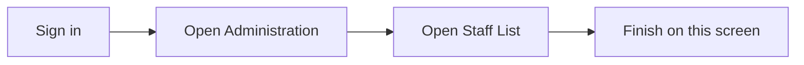

## What this screen is for

**Staff List** is where you record and review work in **Administration**. This guide shows the screen and what to tap or click, step by step.

## Before you start

- You are signed in to Medora.
- Your hospital is selected in the top bar.

## Quick map

## Walkthrough

### Step 1: Open the screen

Sign in with your hospital account.

Select **Testing Hospital 1** in the hospital selector if prompted.

In the left **module bar**, click the **Administration** module icon.

On the Administration home screen, open **Staff List**.

Open the **Staff** section, then the **Staff List** tab.

The screenshot includes the **top bar**, **module strip**, and work area at **1920x1080** (unless overridden).

*Staff List list (1920x1080)*

### Step 2: Edit a row

Click the **edit** (pencil) icon on a row to change an existing record.

*Edit form*

### Step 3: Delete confirmation

Delete shows a confirmation step. Cancel unless you intend to remove data permanently.

*Delete confirmation (cancel unless you intend to remove data)*

## If something goes wrong

- **Blank screen:** ask your hospital administrator to check that your account can see this screen, then reload the page.
- **Cannot save:** check required fields marked with a red star.

## Legal

Only open patient information when your job requires it. Follow your hospital privacy rules.
