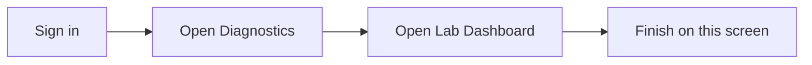

## What this screen is for

**Lab Dashboard** is where you record and review work in **Diagnostics**. This guide shows the screen and what to tap or click, step by step.

## Before you start

- You are signed in to Medora.
- Your hospital is selected in the top bar.

## Quick map

## Walkthrough

_Screenshots for this screen are not available yet._

## If something goes wrong

- **Blank screen:** ask your hospital administrator to check that your account can see this screen, then reload the page.
- **Cannot save:** check required fields marked with a red star.

## Legal

Only open patient information when your job requires it. Follow your hospital privacy rules.
