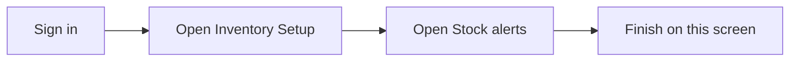

## What this screen is for

**Stock alerts** is where you record and review work in **Inventory Setup**. This guide shows the screen and what to tap or click, step by step.

## Before you start

- You are signed in to Medora.
- Your hospital is selected in the top bar.

## Quick map

## Walkthrough

### Step 1: Open the screen

Sign in with your hospital account.

Select **Testing Hospital 1** in the hospital selector if prompted.

In the left **module bar**, click the **Inventory Setup** module icon.

On the Inventory Setup home screen, open **Stock alerts**.

Under **Stock alerts**, select the **Policy** tab (first sub-page opens by default).

_This guide shows the **Policy** work area inside **Stock alerts**._

The screenshot includes the **top bar**, **module strip**, and work area at **1920x1080** (unless overridden).

*Stock alerts (1920x1080, module bar and form)*

## If something goes wrong

- **Blank screen:** ask your hospital administrator to check that your account can see this screen, then reload the page.
- **Cannot save:** check required fields marked with a red star.

## Legal

Only open patient information when your job requires it. Follow your hospital privacy rules.
